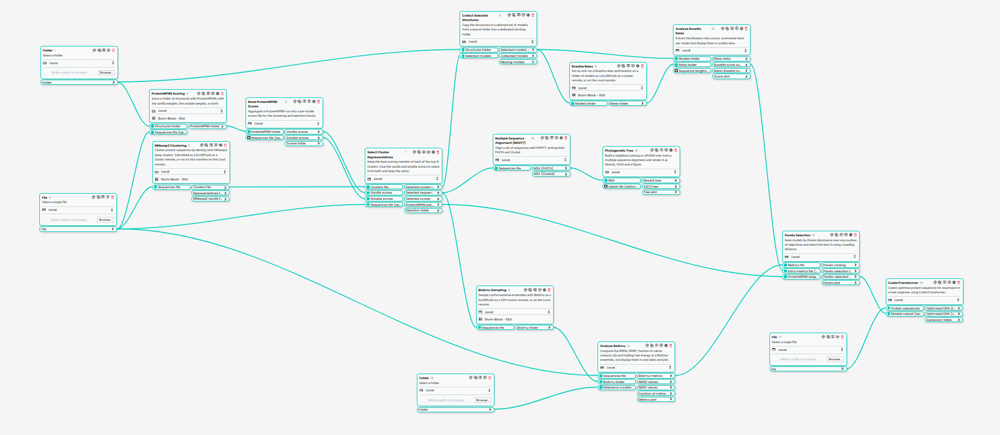

The workflow
============

Given many structures of a protein family, the pipeline selects a few proteins
that are

- **diverse**: at most one per sequence cluster;
- **well designed**: good ProteinMPNN scores, which correlate with sequences that
  fold and express;
- **stable**: low Rosetta energy after relax, and a folded ensemble in BioEmu.

It then prepares them for the lab: codon-optimised DNA, plus an alignment and a
tree to check how diverse the final set is.

Stages
------

1. Score the structures with ProteinMPNN
~~~~~~~~~~~~~~~~~~~~~~~~~~~~~~~~~~~~~~~~~

:ref:`ProteinMPNN Scoring <block-proteinmpnn_scoring>` scores each structure's
own sequence (**score only**) with the **vanilla** and the **soluble** weights.
The soluble weights were trained without membrane proteins, so the two score
sets favour somewhat different proteins. :ref:`Read ProteinMPNN Scores
<block-read_proteinmpnn_scores>` averages the per-sample scores into one
``{model: score}`` table per weight set. **Lower is better.**

2. Cluster the sequences with MMseqs2
~~~~~~~~~~~~~~~~~~~~~~~~~~~~~~~~~~~~~

:ref:`MMseqs2 Clustering <block-mmseqs2_cluster_slurm>` groups the sequences
at a minimum sequence identity (``min_seq_id``, default 0.5) and coverage. Each
cluster is a group of close homologues, so taking one protein per cluster keeps
the final set diverse. To choose the identity threshold, run :ref:`MMseqs2
Threshold Sweep <block-mmseqs2_threshold_sweep>` first: it clusters over a range
of thresholds and plots, for each one, the score distribution of the top-N
representatives it would select. It needs a scores file, so connect it to one
of the ProteinMPNN score outputs. For a CSV with several columns, set **Score
column** to the one to rank by.

3. Pick one representative per cluster
~~~~~~~~~~~~~~~~~~~~~~~~~~~~~~~~~~~~~~

:ref:`Select Cluster Representatives <block-select_cluster_representatives>`
ranks the clusters by their best-scoring member, keeps the top N clusters
(``top_n_clusters``, default 100) and takes the best member of each. It does
this separately for the vanilla and soluble scores and keeps the **union**,
labelling each model *vanilla only*, *soluble only* or *common*. Connect the
sequences file too: the block then writes the selected sequences, which BioEmu
and MAFFT need.

:ref:`Collect Selected Structures <block-collect_selected_pdbs>` copies the
selected models' structures into their own folder.

4. Relax with Rosetta
~~~~~~~~~~~~~~~~~~~~~

:ref:`Rosetta Relax <block-rosetta_relax>` relaxes every selected structure
``nstruct`` times (default 100) with ``rosetta_scripts``. :ref:`Analyse Rosetta
Relax <block-analyse_rosetta_relax>` extracts the energies with PyRosetta and
summarises them per model, including ``score_per_residue`` (mean score divided
by length), which compares proteins of different sizes fairly.

5. Sample conformations with BioEmu
~~~~~~~~~~~~~~~~~~~~~~~~~~~~~~~~~~~

:ref:`BioEmu Sampling <block-bioemu_sampling>` generates an ensemble of
structures for each selected sequence (``num_samples``, default 10,000).
:ref:`Analyse BioEmu <block-analyse_bioemu>` compares each ensemble with the
model's structure:

- **RMSD** and **RMSF**: how far and how much the ensemble moves;
- **Q**, the fraction of native contacts (needs SMOG2): how much of the model's
  fold each sample keeps;
- **dGf**, a folding free energy from the fraction of samples above a Q
  threshold.

dGf needs both folded and unfolded samples. With few samples, or a very stable
protein, every sample is folded and dGf is not computed. That is expected, not
an error.

6. Rank with a Pareto selection
~~~~~~~~~~~~~~~~~~~~~~~~~~~~~~~

:ref:`Pareto Selection <block-pareto_selection>` merges the BioEmu metrics with
the Rosetta summary and ranks the models into Pareto fronts. The default
objectives are **Q_Average** (maximised) and **score_per_residue** (minimised).
Models on the first front are not beaten on both objectives by any other model.
It selects ``n_select`` models (default 10) by front and, within a front, by
crowding distance, which favours models spread along the front. Models missing
any objective (for example, sampled by BioEmu but never relaxed) are dropped,
with a warning.

7. Prepare for expression and inspect the set
~~~~~~~~~~~~~~~~~~~~~~~~~~~~~~~~~~~~~~~~~~~~~

- :ref:`CodonTransformer <block-codon_transformer>` codon-optimises the Pareto
  selection for an expression host (default *E. coli*).
- :ref:`MAFFT <block-mafft_msa>` aligns the selected sequences, and
  :ref:`Phylogenetic Tree <block-phylogenetic_tree>` builds a
  neighbour-joining tree from the alignment, to see how diverse the set is.

The ProteSel Pipeline preset
----------------------------

The whole pipeline ships as a flow. In Horus, open the **Protein Set Selection**
plugin's presets and choose **ProteSel Pipeline**.

         blocks on the left and bottom feed ProteinMPNN Scoring, MMseqs2
         Clustering and Select Cluster Representatives, which branch into the
         Rosetta, BioEmu and MAFFT stages and join again at Pareto Selection and
         CodonTransformer.
   :target: _static/protesel_pipeline.png

   The preset in the Horus flow editor. Click to open it at full size.

How the blocks connect, drawn from the preset itself:

.. include:: reference/pipeline_flow.rst.inc

The main connections:

.. list-table::
   :header-rows: 1

   * - From
     - To
   * - Folder 1 (structures)
     - ProteinMPNN Scoring, Collect Selected Structures
   * - Folder 18 (the same structures)
     - Analyse BioEmu
   * - File 6 (sequences)
     - ProteinMPNN Scoring, MMseqs2 Clustering, Select Cluster Representatives,
       Analyse BioEmu
   * - File 17 (the same sequences)
     - CodonTransformer
   * - Read ProteinMPNN Scores: vanilla / soluble scores
     - Select Cluster Representatives
   * - MMseqs2 Clustering: clusters
     - Select Cluster Representatives
   * - Select Cluster Representatives: selected cluster representatives
     - Collect Selected Structures
   * - Select Cluster Representatives: selected sequences
     - BioEmu Sampling, MAFFT
   * - Select Cluster Representatives: ProteinMPNN weight-set origin
     - Pareto Selection (colours the plot)
   * - Analyse Rosetta Relax: Rosetta score summary; Analyse BioEmu: BioEmu metrics
     - Pareto Selection
   * - Pareto Selection: Pareto-selected models
     - CodonTransformer

The preset's settings are for a production run: Rosetta ``nstruct`` 100 with
101 CPUs, BioEmu 10,000 samples, Pareto 10 models, and ProteinMPNN grouped into
one short job.

Running the preset
~~~~~~~~~~~~~~~~~~

1. The four input blocks come filled in with the lysozyme example
   (``ExampleData/lysozyme``), so the preset runs as it is. For your own data,
   select your structures folder in both **Folder** blocks (1 and 18) and your
   sequences file (FASTA or JSON, keyed by the structure file names) in both
   **File** blocks (6 and 17). The second copy of each sits next to the block it
   feeds, to keep the flow readable. See :doc:`example_data`.

   With the example paths, the Folder and File blocks print *"is not a folder
   on the local machine"* (or *"is not a file"*), and the file preview in the
   editor cannot open them. Both are expected and can be ignored: Horus checks
   the path from the flow's folder, while the plugin's blocks find the example
   inside the plugin. Paths to your own data do not give the warning.
2. Assign the remotes: ProteinMPNN and BioEmu to your GPU remote, MMseqs2 and
   Rosetta to your CPU remote, and check the blocks' cluster software settings
   against your site (see :doc:`remotes`). Leave the rest on Local.
3. For a quick test, reduce the expensive settings first: Rosetta ``nstruct`` 2
   (and **CPUs** 3), BioEmu ``num_samples`` 10, Pareto ``n_select`` below the
   number of representatives.
4. Run the flow from the first block. Horus runs each block once its inputs are
   ready and waits for the cluster jobs.

Where the results are
~~~~~~~~~~~~~~~~~~~~~

Horus runs the flow in a folder named after the flow, next to the ``.flow``
file. The main outputs:

.. list-table::
   :header-rows: 1

   * - File or folder
     - Content
   * - ``proteinmpnn/``, ``proteinmpnn_scores_vanilla.json``, ``proteinmpnn_scores_soluble.json``
     - ProteinMPNN runs and per-model scores
   * - ``mmseqs_clustering/``, ``mmseqs_clusters.json``
     - MMseqs2 run and ``{representative: [members]}``
   * - ``selected_models.json``, ``selected_sequences.fasta``, ``selected_origin.json``, ``selection_table.csv``
     - the cluster representatives
   * - ``selected_models/``
     - their structures
   * - ``relax_selected_models/``, ``rosetta_score_summary.csv``
     - Rosetta relax output and per-model energies
   * - ``bioemu_sampling/``, ``bioemu_metrics.csv``
     - BioEmu ensembles and per-model metrics
   * - ``pareto_ranked_models.csv``, ``pareto_selected_models.json``, ``pareto_selection_plot.png``
     - the Pareto ranking and final selection
   * - ``codon_optimised_dna.fasta``
     - the DNA for the final selection
   * - ``msa.fasta``, ``phylogenetic_tree.nwk``, ``phylogenetic_tree.png``
     - alignment and tree

Rerunning and resuming
----------------------

Running a block in Horus also reruns every block **downstream** of it. The
blocks are built so that rerunning is cheap and safe.

**Skip finished (default on).** ProteinMPNN Scoring, Rosetta Relax and BioEmu
Sampling reuse their existing folder and only submit the models that are not
finished. A run that stopped half-way, for example a Rosetta job that hit its
walltime, resumes where it stopped: rerun the block and only the unfinished
models are submitted. If everything is already finished, the block completes
without submitting anything.

**MMseqs2 Clustering** reuses an existing clustering when the sequences and
settings are the same. If you change ``min_seq_id``, coverage or the sequences,
it stops and says what changed. Use a new folder name, or turn on **Remove
existing results**, to recluster.

**Remove existing results** deletes the block's folder and starts over, but
**only when you run that block itself**. When a run started further up reaches
the block, the results are kept and the log says so. Leaving the option on is
therefore safe: it will not delete a finished calculation because you changed
something upstream. (This needs a Horus version that records which block a run
was started from. On older versions the results are always kept; delete the
folder by hand to start over.)

**A cluster block that ended in a failed or unknown state** after its job
finished: use the block's **Continue** action, not **Run**. Continue skips the
submission and downloads the results. Run submits the job again.
